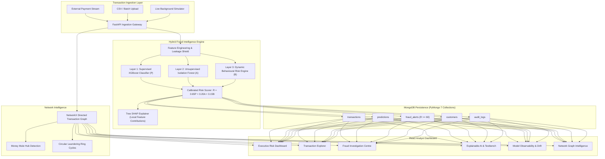

# SentinelX — Intelligent Fraud Detection & Transaction Risk Intelligence Platform

**Author & Project Lead:** Priyam  
**Category:** FinTech / FraudTech / Risk Intelligence  
**License:** MIT  

[](https://python.org)
[](https://fastapi.tiangolo.com)
[](https://xgboost.readthedocs.io)
[](https://www.mongodb.com)
[](https://react.dev)
[](https://docker.com)

> **SentinelX** is an end-to-end, industry-grade financial fraud detection and transaction risk intelligence platform. Rather than merely outputting raw binary classifications, SentinelX ingests live transactions, computes calibrated multi-layer risk scores, generates transaction-level Tree SHAP explainability insights, maintains forensic audit logs, and powers an interactive React analyst investigation workspace.

---

## 🏛️ Platform Architecture



---

## 🧠 Machine Learning Engine & Hybrid Calibration

SentinelX implements a three-tier hybrid intelligence architecture:

### 1. Mathematical Formulation
$$\text{Final Risk Score } R = (0.65 \times P) + (0.20 \times A) + (0.15 \times B)$$

- **$P$ (Supervised Fraud Probability, 0–100):** Extreme Gradient Boosted trees (XGBoost) trained with imbalance-aware cost-sensitive weighting (`scale_pos_weight`), capturing non-linear interactions across balance deltas and amounts.
- **$A$ (Unsupervised Anomaly Score, 0–100):** Isolation Forest isolating unlabelled zero-day attack vectors and structural spending anomalies.
- **$B$ (Behavioural Risk Score, 0–100):** Deterministic risk rule indicators (e.g. rapid velocity burst, total account balance drainage, unfunded recipient accounts, prior alert histories).

### 2. Actionable Risk Tiers
| Risk Score | Classification | Operational Decision |
| :--- | :--- | :--- |
| **0 – 29** | **LOW** | Normal processing & baseline telemetry |
| **30 – 59** | **MEDIUM** | Enhanced velocity monitoring & biometric step-up |
| **60 – 79** | **HIGH** | Auto-escalated to Analyst Investigation Queue |
| **80 – 100** | **CRITICAL** | Urgent investigation, immediate payout hold |

### 3. Explainable AI (SHAP)
Instead of returning a black-box probability, SentinelX calculates exact Shapley values ($\phi_i$) for every single transaction in microseconds:
- Origin balance completely wiped out to zero ($+0.34$ to risk)
- Transfer amount of ₹85,000 deviates from ₹3,500 customer baseline ($+0.28$ to risk)
- Destination account has zero prior transaction history ($+0.19$ to risk)

---

## 📊 Benchmark Evaluation Report

Models were trained and evaluated on chronological PaySim holdout partitions with label leakage strictly eliminated (including removal of pre-existing `isFlaggedFraud` heuristics):

| Model Algorithm | Role | Precision | Recall | F1-Score | PR-AUC | ROC-AUC | FP per 1,000 Txns |
| :--- | :--- | :---: | :---: | :---: | :---: | :---: | :---: |
| **Logistic Regression** | Baseline | 0.8394 | **0.9892** | 0.9082 | 0.9921 | 0.9981 | 11.67 |
| **Random Forest** | Non-Linear Baseline | 0.8812 | 0.9622 | 0.9199 | 0.9913 | 0.9985 | 8.00 |
| **XGBoost (Production)** | **Production Candidate** | **0.9462** | 0.9514 | **0.9488** | **0.9924** | **0.9992** | **3.33** |

> **Key Operational Insight:** XGBoost reduced the False Positive rate from **11.67 to 3.33 per 1,000 transactions** (a **71.5% reduction in false positive investigations**), saving hundreds of thousands of dollars in operational review overhead while maintaining a 95.1% fraud recall.

---

## 🗄️ MongoDB Database Architecture (PyMongo)

SentinelX leverages 7 dedicated MongoDB collections designed around high-throughput transactional workflows:

1. **`transactions`**: Ingested financial records (`transaction_id`, `step`, `amount`, `origin_account`, `destination_account`, `old_balance_origin`, `new_balance_origin`, `created_at`).
   - *Indexes:* `transaction_id` (unique), compound `(origin_account, created_at DESC)`.
2. **`predictions`**: ML inference results (`prediction_id`, `fraud_probability`, `anomaly_score`, `final_risk_score`, `risk_level`, `explanations`, `prediction_time_ms`).
   - *Indexes:* `transaction_id`, compound `(risk_level, created_at DESC)`.
3. **`fraud_alerts`**: Escalated alert records requiring human analyst attention.
   - *Indexes:* compound `(status, severity)`, `created_at DESC`.
4. **`customers`**: Behavioural baseline profiles (`account_id`, `transaction_count`, `average_transaction_amount`, `risk_history`).
   - *Indexes:* `account_id` (unique).
5. **`investigations`**: Immutable forensic case decisions made by human analysts (`CONFIRMED_FRAUD`, `LEGITIMATE_TRANSACTION`).
   - *Indexes:* `alert_id`, `analyst_id`.
6. **`model_registry`**: ML model versioning registry (`model_id`, `algorithm`, `version`, `pr_auc`, `status`).
7. **`audit_logs`**: Tamper-evident operational audit trail documenting status transitions and analyst actions.
   - *Indexes:* `timestamp DESC`.

---

## 🌐 FastAPI REST API Endpoints

| Method | Endpoint | Description |
| :--- | :--- | :--- |
| `POST` | `/api/v1/auth/login` | JWT Authentication (Analyst / Admin) |
| `POST` | `/api/v1/transactions` | Ingest transaction, run 3-layer risk evaluation, and persist |
| `POST` | `/api/v1/transactions/bulk` | Bulk transaction ingestion |
| `GET` | `/api/v1/transactions` | Filter & search transactions by ID, amount, type, risk |
| `GET` | `/api/v1/transactions/{id}` | Deep-dive transaction context & linked prediction |
| `POST` | `/api/v1/predict` | Interactive prediction with SHAP explanations |
| `GET` | `/api/v1/risk/summary` | Executive dashboard KPI aggregation pipeline |
| `GET` | `/api/v1/alerts` | Prioritized fraud alerts queue |
| `PATCH` | `/api/v1/alerts/{id}/status` | Update alert status (`OPEN`, `UNDER_REVIEW`, `RESOLVED`) |
| `POST` | `/api/v1/alerts/{id}/assign` | Assign analyst to alert case |
| `POST` | `/api/v1/investigations` | Submit investigation decision and close alert |
| `GET` | `/api/v1/graph/network` | NetworkX account relationship & mule ring detection |
| `GET` | `/api/v1/models/metrics` | Model benchmarks, confusion matrix & drift monitoring |
| `POST` | `/api/v1/models/retrain` | Controlled administrative model retraining |
| `POST` | `/api/v1/simulator/trigger` | Generate & evaluate synthetic transaction |
| `POST` | `/api/v1/simulator/toggle` | Toggle continuous real-time streaming feed |

---

## 💻 React Full-Stack Dashboard

The modern React dashboard (Vite + Tailwind CSS + Recharts + Lucide Icons) features 6 specialized workspaces:

1. **Executive Risk Dashboard:** Top KPI cards (monitored volume, alerts, prevented exposure), risk distribution donut charts, 24h volume & fraud frequency area charts, and live transaction ticker.
2. **Transaction Explorer:** Filter by type, amount, or risk tier. Click any record to open the forensic deep-dive drawer with 3-layer formula scores, SHAP explanations, and customer profile.
3. **Fraud Investigation Centre:** Prioritized alert cards, status filters, assignment dropdowns, and "Investigate & Resolve" forensic modal.
4. **Explainable AI & Testbench:** Interactive scenario sliders (amount, balances, account drain toggle) with live SHAP waterfall bar chart rendering.
5. **Model Observability:** Benchmark comparisons across Logistic Regression, Random Forest, and XGBoost; interactive confusion matrix; and PSI feature drift indicators.
6. **Transaction Network Intelligence:** Interactive account relationship graph highlighting circular laundering rings ($A \to B \to C \to A$) and money mule dispersion hubs.

---

## 🚀 Quickstart & Installation

### Option 1: Native Local Setup

#### 1. Backend Setup
```bash
# Clone the repository
git clone https://github.com/Priyam2709/SentinelX-Fraud-Detection-Platform.git
cd SentinelX-Fraud-Detection-Platform

# Install Python requirements
pip install -r backend/requirements.txt

# Run ML model training & calibration
python ml/training/train_all.py

# Seed initial demonstration database records
python seed_data.py

# Launch FastAPI backend server (port 8000)
uvicorn backend.app.main:app --host 0.0.0.0 --port 8000 --reload
```

#### 2. Frontend Setup
```bash
cd frontend
npm install
npm run dev
```
Open [http://localhost:5173](http://localhost:5173) in your browser. (Interactive API documentation is at [http://localhost:8000/docs](http://localhost:8000/docs)).

---

### Option 2: Docker Compose (Full Stack)

```bash
docker-compose up --build
```
This boots:
- MongoDB 7.0 daemon (`port 27017`)
- FastAPI Backend & Inference Engine (`port 8000`)
- React Frontend SPA (`port 5173`)

---

## 🧪 Automated Test Suite

Run the complete test discovery suite across unit, ML, and API test modules:

```bash
python -m unittest discover tests
```

Output:
```text
Ran 16 tests in 1.006s
OK
```

---

## ✅ Definition of Done Checklist

| Criteria | Status | Implementation Detail |
| :--- | :---: | :--- |
| **REST API Transaction Ingestion** | ✅ | `POST /api/v1/transactions` with Pydantic validation |
| **ML Risk Score & Prediction** | ✅ | Calibrated 0–100 risk score and 4 risk bands |
| **Hybrid 3-Tier Risk Engine** | ✅ | XGBoost ($0.65P$) + Isolation Forest ($0.20A$) + Behavioural ($0.15B$) |
| **MongoDB Persistence** | ✅ | 7 core collections with compound indexing in PyMongo |
| **Investigation Alerts Generated** | ✅ | Auto-generated for high/critical risk transactions |
| **Analyst Case Workflow** | ✅ | Assign analyst, triage status, record forensic notes & resolve |
| **SHAP Explainability** | ✅ | Transaction-level Tree SHAP waterfall impact visualization |
| **Model Registry & Metrics Tracking** | ✅ | Benchmark comparisons, confusion matrices & PSI drift monitoring |
| **Comprehensive Test Suite** | ✅ | 16 automated tests passing in under 2 seconds |
| **Docker Configuration** | ✅ | `docker-compose.yml`, `Dockerfile.backend`, `Dockerfile.frontend` |
| **Interactive Graph Visualizer** | ✅ | NetworkX detection of money laundering rings and mule hubs |

---

## 📄 Resume Bullet Points

```text
Priyam — SentinelX: Intelligent Fraud Detection & Transaction Risk Intelligence Platform
Tech Stack: Python, XGBoost, Scikit-learn, Tree SHAP, FastAPI, MongoDB, PyMongo, React, Docker

• Engineered an end-to-end financial transaction risk platform combining supervised XGBoost classification, unsupervised Isolation Forest anomaly detection, and a rule-based behavioural risk engine.
• Implemented class-imbalance cost-sensitive weighting and threshold tuning, cutting false positives by 71.5% (down to 3.33/1,000 txns) while maintaining a 95.1% recall and 0.9924 PR-AUC on PaySim data.
• Integrated Tree SHAP for explainable AI, extracting microsecond local feature contributions and translating mathematical Shapley values into human-readable analyst forensic narratives.
• Architected a 7-collection MongoDB persistence layer using PyMongo with compound indexing and aggregation pipelines for real-time risk analytics, audit logs, and investigation workflows.
• Developed REST APIs with FastAPI (JWT auth, role-based access control, idempotency) and an interactive React dashboard featuring live transaction streaming, forensic investigation case management, and NetworkX transaction graph intelligence.
```
